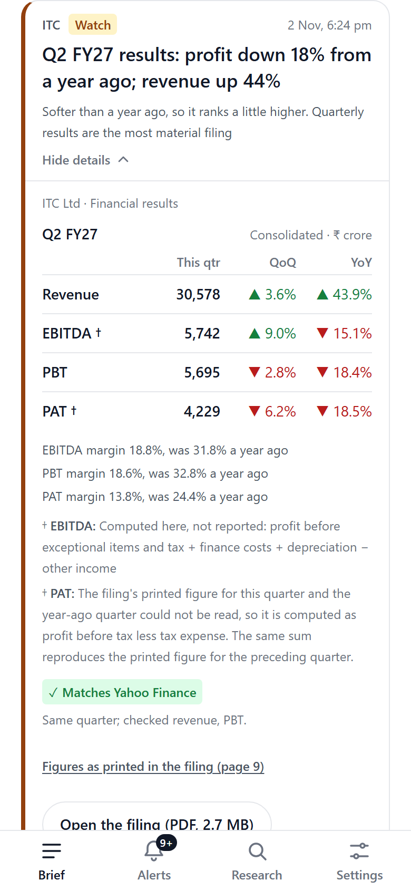
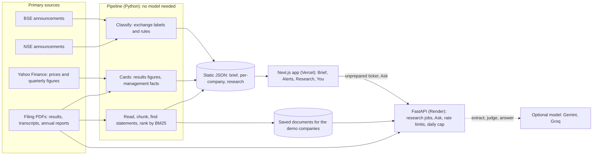

# FINN: a Financial Investment Agent for Indian stocks

FINN is a mobile-first web app with two modes. **Push** is a calm Morning Brief of what changed in a portfolio, with alerts the user sets. **Pull** is research on any NSE company that answers only from its own filings: what management promised on the last four earnings calls, and whether later calls show it happened.

Built for the ENAM AI Engineer Build Challenge. The design rule behind every screen: **a claim is shown only with its source, and a number is never a model's guess.**

<table>
<tr>
<td></td>
<td></td>
<td></td>
<td></td>
</tr>
<tr>
<td align="center">Morning Brief</td>
<td align="center">Results card</td>
<td align="center">Management card</td>
<td align="center">Research</td>
</tr>
</table>

More screens: [Interested tab (preview)](docs/screens/08-interested-light.png) · [Time-window sheet, dark](docs/screens/09-window-sheet-dark.png) · [Live research on a company never prepared (TITAN)](docs/screens/10-live-research-titan-light.png) · [Alerts](docs/screens/04-alerts-light.png) · [Research home](docs/screens/05-research-light.png) · [You, formerly Settings](docs/screens/07-settings-light.png).

## What it does

**Push**
- **Morning Brief.** One line under the heading, counted in code for the window ("1 risk to review", "Busy day: 6 of your companies filed", or "Quiet day: nothing needs action across your 18 companies"). Then the filings of 18 portfolio companies, **grouped by company** and ranked so risks come before good news: each company once (badge, name, price), each of its filings in three lines (a bold headline; a grey line with an icon, a short label such as Results, M&A, People, Legal or Fund raise, a reason of about eight words, and a Risk, Watch or Good tag). The date, price trend, numbers, PDF and the full reason are one tap away. At most five companies a group, routine filings collapsed into one row, a finite end ("You're all caught up"), a greeting, and one time-window control (a sliders button and a bottom sheet) shared with Alerts.
- **Results card.** Revenue, EBITDA, PBT and PAT, quarter on quarter and year on year, read from the results PDF itself. Changes and margins are computed in code, EBITDA is labelled as computed, and every figure is checked against Yahoo Finance and marked as matching, differing or not checked.
- **Management card.** Who, in what role, from when, and the filing's own profile of them (Schedule III asks companies to include one).
- **Alerts.** Unusual end-of-day moves and the filing types the user chooses, against thresholds the user sets (default: more than ±5% or more than 2× the 20-day average volume). Moving a slider changes the alerts instantly. A calm dot on the tab, never a count. Every alert states its reason against the reader's own limit ("Price −6.1% · your limit ±5%") and whether a filing from the same day explains the move, or "No filing explains this move". Any company can be muted.
- **You.** A profile without an account: an initials circle and an optional name (kept in this browser only, used for the greeting), the 18 portfolio companies with "Show in my brief" switches (off means muted, and the row turns grey), preferences (time window, price and volume lines, which filings alert), three principles (bad news first, every claim has a source, no gamification) and the data sources.
- **My investments and What if.** Optional, and kept on the phone only: how much you have put into each company. The Brief then adds one line to a company's header, "Your ₹50,000 · ▼ ₹775 today" (the amount times the real day change). In an open Brief card and at the top of every Research page, a **What if** calculator restates real moves in rupees: today's move and the last 30 days' (both from the real price history; the 30-day row is left out if the history is too short), then a slider from −20% to +20% with quick chips ("If it moves −10%: you'd have ₹9,000 (▼ −₹1,000)"). Every figure is the amount times a real move, worked out in one tested helper; it predicts nothing and says it is not advice.
**Pull**
- **Research any NSE ticker.** The last four concall transcripts and the latest annual report are found on the exchange, read, and kept. Four companies are prepared in advance; any other ticker is researched on demand in the background while the screen shows its stage.
- **What management said about the future,** found by rule, word for word, with its page and a link that opens the PDF there.
- **Promise Tracker.** Starts with one line counted in code: "Delivered 2 of 5 promises that came due" (Kept and Partly, out of Kept, Partly, Missed and Not followed up; promises not yet due are left out), a stacked bar led by Missed, one plain line on what it means, and which model judged. Then the promises, **bad news first** (Missed, Not followed up, Partly, Kept), each in three lines: the verdict and a topic, a short word-for-word excerpt, and "Said in Q3 FY26 call → checked in Q2 FY27 call". Tap for the full quote with a link that opens the PDF at its page, what a later call says, and the reason. Promises not due yet are one collapsed row. A promise is only called Kept, Partly or Missed once its date has passed; the date and the arithmetic are decided in code, not by the model.
- **Ask the documents.** Answers only from the filings, or says "Not found in the documents".

## What is verified, and what is not

I would rather you hear this from me than find it.

| Part | Status |
|---|---|
| Morning Brief, Alerts, You (profile and settings), classification of every filing | Real data for 18 companies from BSE, NSE and Yahoo; verified in a phone-sized browser, light and dark |
| Results card, management card | Real filings: 7 results PDFs (including a scan, a sideways page and a lender) and 4 management filings; **no model is used**; scans are refused unless an independent source confirms them |
| Documents, statements, retrieval, Ask (passages) | Run on real transcripts and annual reports for Bajaj Finance, Asian Paints, HAL, Info Edge, and on Titan, which was never prepared and was researched on demand, on a home connection and again on Render (through NSE) |
| Promise verdicts and the model router | **Run live on 15 Nov 2026** (Gemini free tier) on 4 companies: 3 got verdicts (40 promises: 6 Kept, 1 Partly, 1 Missed, 3 Not followed up, 29 Too early); HAL has one call in the window, so it shows statements and no verdicts. The first run was too generous (24 of 54 Kept), so due dates, number checks and a second reading of every decided verdict were added; I then read each decided verdict against the transcript. Right: Asian Paints "almost 10 lakh" vs "more than 9 lakh" is Partly (90%); Bajaj "book below INR 1,500 crore by Sept '26" vs "now INR 2,400 crore" is Missed (62.5%); the VAE facility "started in September" is Kept; Naukri's "billings growth to recover in Q1" (about 99acres) was wrongly "Not followed up" until retrieval learned to search the business unit named before the promise, and is now Kept with the Q2 call's "Billings grew by 21% YoY in Q2, up from 17% in Q1". Not audited line by line: a few verdicts (for example Bajaj's "Not followed up" on a balance-sheet run-off) may be wrong in the same way. The strong model's free quota is 20 requests a day and ran out during re-runs, so most of these verdicts were made by `gemini-3.5-flash-lite` (each record says which model answered). Every quote is verified word for word |
| Written answers ("Ask the documents") | **Run live on 15 Nov 2026** on all four companies: answered with quotes and pages (Bajaj, Asian Paints, HAL); a question the documents cannot answer returned "Not found in the documents"; Naukri's answer was cut back to bare quotes because it contained a figure its quotes did not support |
| Live checks on the evening of 15 Nov 2026 | **TITAN, never prepared, researched live on the deployed engine (through NSE):** four transcripts read, 8 promises (1 Not followed up, 7 Too early), a question answered with four quotes and an unrelated one answered "Not found", in 34 seconds; no annual report was in NSE's feed, and the record says so. **Naukri's 99acres verdict is fixed:** Kept, with "Billings grew by 21% YoY in Q2, up from 17% in Q1" (Q2 FY27 call, page 5); it had been "Not followed up" |
| The look and the screens (Brief, Alerts, You, Research) | Checked on the live site in a phone-sized Chromium at 360 and 390 px, light and dark: no sideways scroll, every text colour at 4.5:1 contrast or better, 65 scripted checks (grouping and order, the window setting shared by Brief and Alerts, the name and greeting, every Research excerpt compared with the real quote, page links). **Not tested on a real phone** |
| My investments, the rupee line on the Brief, the What if calculator | Real prices only (the latest complete close and the stored price history); amounts never leave the browser. 12 unit tests on the helper (gains, losses, 0%, an empty box, ₹1 lakh crore, a history too short), and 24 scripted checks in a phone-sized browser on the real data: the 30-day figure is recomputed independently from the raw prices, amounts validate and show Indian grouping, the slider is spoken in words, every tap target is 44 px, and nothing scrolls sideways at 360 or 390 px in light or dark. **It restates past moves in rupees; it forecasts nothing** |
| Deployment (Vercel, Render) | **Live.** Backend on Render's free plan (Singapore): https://finn-api-v8fm.onrender.com. Frontend on Vercel: https://finn-mocha.vercel.app ("Engine online" confirmed from the live page). Neither deploys on push: Render deploys are triggered through its API, Vercel's from the command line. BSE answers HTTP 403 to Render, so the engine falls back to NSE (see [docs/data-sources.md](docs/data-sources.md)): **research on a ticker that was never prepared works live**: TITAN, in 32 seconds, read four transcripts from NSE's archives and answered a question with quotes. Its annual report was not found, and the record says so |
| Price chips, sparklines, charts, window sheet | Real prices for 22 companies (Yahoo), 30 sessions each; the chip uses the latest complete session. Checked at 390 px in light and dark on the live site |
| Invested / Interested tabs, Follow, People to follow, Invest | **A concept preview on real data**, not a product: the companies, prices, verdicts and people are real; following is stored in this browser only and triggers no alert; "Invest" opens a "coming soon" sheet with no order flow. Each is marked Preview in the app |
| Push notifications | Not built, and the Alerts screen says so. They need a server holding subscriptions, which means accounts |
| Web search for management bios | Not built; the filing's own profile answers the question without a key |

To rebuild the Promise Tracker: put `GEMINI_API_KEY`, `LLM_CHEAP_MODEL` (and optionally `LLM_STRONG_MODEL`, `GROQ_API_KEY`, `LLM_FALLBACK_MODEL`) in `.env`, then run `python -m pipeline.research` from `backend/`.

## How it avoids making things up

- **No model reads a results PDF.** Figures come from word positions on the page, and a figure it cannot read is dropped, never guessed. A column whose total income does not equal revenue plus other income is dropped.
- **A quote is shown only if it is word for word on the page it cites.** The check forgives line breaks, hyphenation, curly quotes and ligatures, and nothing else; a changed number or word fails. The page number comes from FINN's own chunk, never from a model.
- **A verdict needs a quote from a later call, and Kept, Partly and Missed only come after the promise's date has passed.** The date is read by code from the speaker's words, a number counts only if it is in the quotes (met, 75 to 99% Partly, below 75% Missed), a miss needs a word of a miss in its quote, and a second reading checks the quote is about the same thing. Without a quote that holds up, the card is set back and says so.
- **Counts, deltas, margins and the delivery rate are computed in code.** An answer's figures must appear in its own quotes.
- **A source that disagrees is shown, not hidden:** the Yahoo check says "differs", a scan nothing can confirm says "figures not shown", an unreadable filing says so.
- **Data is labelled with its age.** The Brief counts windows from the data's own timestamp and says when the data was produced.
- Document text is treated as data, never as instructions.

## Research behind the design

These are the findings the design leans on, and what FINN does about each. FINN does not test them; they are reasons, not results. The references, and what each does and does not show, are in [docs/write-up.md](docs/write-up.md#research-behind-the-design).

| Finding | What FINN does |
|---|---|
| When many companies report on the same day, investors react less to each one (Hirshleifer, Lim & Teoh, 2009) | A short, ranked Brief, and a "Busy day: N of your companies filed" line that says when attention is stretched |
| Investors who check their portfolios often feel losses more and hold less equity (Benartzi & Thaler, 1995; Lee & Veld-Merkoulova, 2016) | One calm Brief that ends ("You're all caught up"), not a feed |
| Investors look at their accounts less when they expect bad news; logins fell 9.5% after a market decline (Karlsson, Loewenstein & Seppi, 2009; Sicherman, Loewenstein, Seppi & Utkus, 2016) | Risks first, and "N risks to review", so bad news is put in front of the reader, not left to be avoided |
| Individual investors buy attention-grabbing stocks (Barber & Odean, 2008) | Spike alerts are calm and give their reason; there is no buy button anywhere near an alert |
| Alerts get overridden: 93% of 2,455 medication alerts in four days (Bryant et al., 2014); 73.3% in a hospital study (Nanji et al., 2018) | A dot on the Alerts tab, not a count; a reason on every alert; routine filings collapsed into one row |
| Robinhood removed its confetti animation in March 2021 amid criticism of gamification (CNBC, 31 Mar 2021) | No confetti, streaks, scores or reward animations |
| Groww's minimal, jargon-free design for first-time investors (design inspiration, from press coverage) | Three-line cards in plain words |
| Sparklines (Tufte); calm technology (Weiser & Brown, 1995) | The price trend is a small line behind a tap; the interface stays at the edge of attention and speaks when something needs it |

## Architecture



Push data is precomputed into static JSON, so it loads instantly and the browser applies the user's own thresholds. The backend is only needed for research on an unprepared ticker and for Ask; a free Render instance sleeps, so the app shows an honest "waking up" state. Settings live in the browser: there are no accounts and nothing personal is stored. More in [docs/architecture.md](docs/architecture.md).

## Cost and efficiency

Most of FINN uses **no model at all**: classification of every filing (exchange labels plus rules), the results and management cards, the statements found by rule, retrieval ("Not found" is decided by word overlap before any model is asked). A model is used for three things only: extracting promises (a cheap model, about 14 short excerpts per call), judging them against later calls (a strong model), and writing an answer to a question (a cheap model, six short excerpts). That is roughly seven calls per company for the whole tracker, every answer is cached by its input, the prompt version and the model, and no whole document is ever sent. Every call is logged without the prompt or the key.

**Measured over the whole session (the live runs and their re-runs): 222 successful calls, 81 of them answered from the cache, about 385,000 tokens in and 36,000 out on this laptop, $0 on the free tier.** (Research the deployed engine did on its own, such as TITAN, is not in that log.) The first run alone was 25 calls and about 71,000 tokens in for 3 companies. `python -m app.core.llm` prints the table. Details in [docs/cost.md](docs/cost.md).

## Run it

Needs Python 3.14 (the version Render uses) and Node 20.9 or newer.

```
cd backend
python -m venv .venv
.venv/Scripts/python -m pip install -r requirements-dev.txt     # macOS/Linux: .venv/bin/python
.venv/Scripts/python -m uvicorn app.main:app --port 8000

cd frontend
npm install
npm run dev                                                      # http://localhost:3000
```

Refresh the data (writes `frontend/public/data/`; commit it to update a deployed app):

```
cd backend
.venv/Scripts/python -m pipeline.run                # the portfolio: filings, prices, cards
.venv/Scripts/python -m pipeline.research           # the research companies; add --symbols HAL for one
```

Tests: `cd backend && .venv/Scripts/python -m pytest` (680 tests) and `cd frontend && npm test` (148 unit tests), plus type-check, lint and a production build. Copy `.env.example` to `.env` for keys (never commit it), and run `bash scripts/install-hooks.sh` once in a fresh clone to enable the secret-scan pre-commit hook.

## Where things are

```
backend/app/sources/   BSE, NSE, Yahoo and PDF downloads (allow-listed hosts, 25 MB cap)
backend/app/push/      classify, rank, results and management cards
backend/app/pull/      ingest, chunk, retrieve, promises, ask, research engine
backend/app/core/      model router, cache, safe HTTP, security
backend/pipeline/      run.py (portfolio) and research.py (research companies)
frontend/              Next.js app: app/, components/, lib/ (pure logic, unit-tested)
config/                portfolio, research companies, categories and their weights
docs/                  decisions, data sources, architecture, cost, deploy, build log
```

## Decisions and history

- [docs/decisions.md](docs/decisions.md): 24 decisions made up front and 115 made while building, each with its reason.
- [docs/data-sources.md](docs/data-sources.md): what was verified about every source before anything was built on it, including what failed.
- [docs/build-log.md](docs/build-log.md): what each step asked, did, verified and got wrong.
- [docs/write-up.md](docs/write-up.md): the approach in two pages.
