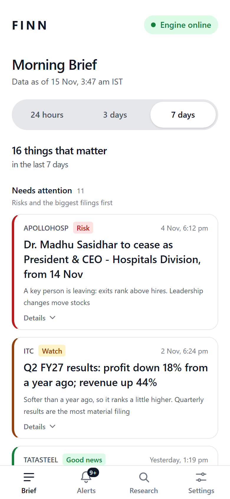
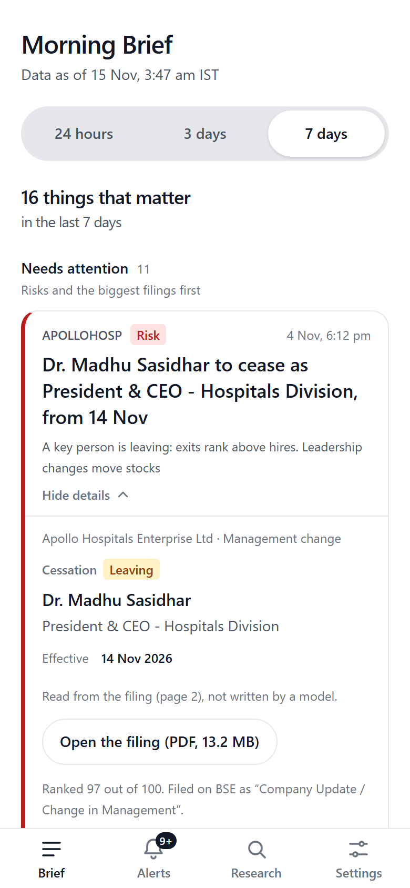
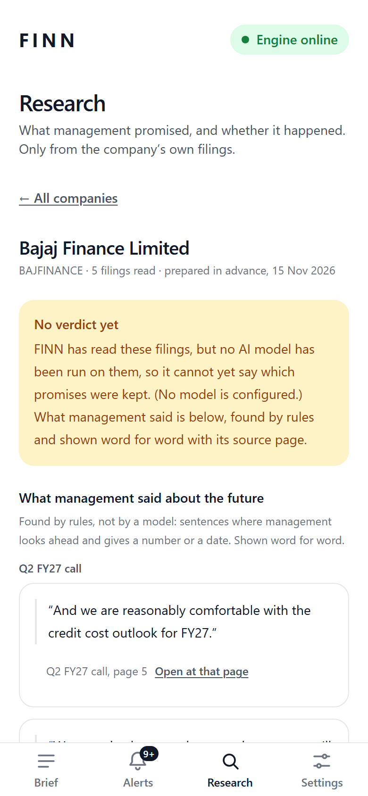

# FINN: a Financial Investment Agent for Indian stocks

FINN is a mobile-first web app with two modes. **Push** is a calm Morning Brief of what changed in a portfolio, with alerts the user sets. **Pull** is research on any NSE company that answers only from its own filings: what management promised on the last four earnings calls, and whether later calls show it happened.

Built for the ENAM AI Engineer Build Challenge. The design rule behind every screen: **a claim is shown only with its source, and a number is never a model's guess.**

<table>
<tr>
<td></td>
<td></td>
<td></td>
<td></td>
</tr>
<tr>
<td align="center">Morning Brief</td>
<td align="center">Results card</td>
<td align="center">Management card</td>
<td align="center">Research</td>
</tr>
</table>

More screens: [Alerts](docs/screens/04-alerts-light.png) · [Research home](docs/screens/05-research-light.png) · [Settings](docs/screens/07-settings-light.png).

## What it does

**Push**
- **Morning Brief.** "N things that matter" for the last 24 hours, 3 or 7 days: the filings of 18 portfolio companies, ranked so risks come before good news, in groups of at most five cards, with routine filings collapsed into one row and a finite end ("You're all caught up"). Every card says why it ranked where it did.
- **Results card.** Revenue, EBITDA, PBT and PAT, quarter on quarter and year on year, read from the results PDF itself. Changes and margins are computed in code, EBITDA is labelled as computed, and every figure is checked against Yahoo Finance and marked as matching, differing or not checked.
- **Management card.** Who, in what role, from when, and the filing's own profile of them (Schedule III asks companies to include one).
- **Alerts.** Unusual end-of-day moves and the filing types the user chooses, against thresholds the user sets (default: more than ±5% or more than 2× the 20-day average volume). Moving a slider changes the alerts instantly. Any company can be muted.

**Pull**
- **Research any NSE ticker.** The last four concall transcripts and the latest annual report are found on the exchange, read, and kept. Four companies are prepared in advance; any other ticker is researched on demand in the background while the screen shows its stage.
- **What management said about the future,** found by rule, word for word, with its page and a link that opens the PDF there.
- **Promise Tracker** (Kept / Partly / Missed / Too early, each with the quote, the document and the page). **Needs a model key; see the status table below.**
- **Ask the documents.** Answers only from the filings, or says "Not found in the documents".

## What is verified, and what is not

I would rather you hear this from me than find it.

| Part | Status |
|---|---|
| Morning Brief, Alerts, Settings, classification of every filing | Real data for 18 companies from BSE, NSE and Yahoo; verified in a phone-sized browser, light and dark |
| Results card, management card | Real filings: 7 results PDFs (including a scan, a sideways page and a lender) and 4 management filings; **no model is used**; scans are refused unless an independent source confirms them |
| Documents, statements, retrieval, Ask (passages) | Run on real transcripts and annual reports for Bajaj Finance, Asian Paints, HAL, Info Edge, and Titan, which was never prepared and was researched on demand |
| **Promise verdicts, written answers, the model router** | **Built and tested against a scripted model. Not run against a live model: there were no API keys.** Until a key is added, Research says "No verdict yet" and shows the statements instead |
| Deployment (Vercel, Render) | Not done yet; click-by-click steps are in [docs/deploy.md](docs/deploy.md). BSE and NSE are only proven reachable from a home connection, so on a server an unprepared ticker may fail, with a stated reason |
| Push notifications | Not built, and the Alerts screen says so. They need a server holding subscriptions, which means accounts |
| Web search for management bios | Not built; the filing's own profile answers the question without a key |

To turn on the Promise Tracker: put `GEMINI_API_KEY`, `LLM_CHEAP_MODEL` (and optionally `LLM_STRONG_MODEL`, `GROQ_API_KEY`, `LLM_FALLBACK_MODEL`) in `.env`, then run `python -m pipeline.research` from `backend/`.

## How it avoids making things up

- **No model reads a results PDF.** Figures come from word positions on the page, and a figure it cannot read is dropped, never guessed. A column whose total income does not equal revenue plus other income is dropped.
- **A quote is shown only if it is word for word on the page it cites.** The check forgives line breaks, hyphenation, curly quotes and ligatures, and nothing else; a changed number or word fails. The page number comes from FINN's own chunk, never from a model.
- **A verdict other than "Too early" needs a quote from a later call.** Without one it is set back, and the card says so.
- **Counts, deltas, margins and the delivery rate are computed in code.** An answer's figures must appear in its own quotes.
- **A source that disagrees is shown, not hidden:** the Yahoo check says "differs", a scan nothing can confirm says "figures not shown", an unreadable filing says so.
- **Data is labelled with its age.** The Brief counts windows from the data's own timestamp and says when the data was produced.
- Document text is treated as data, never as instructions.

## Architecture


Push data is precomputed into static JSON, so it loads instantly and the browser applies the user's own thresholds. The backend is only needed for research on an unprepared ticker and for Ask; a free Render instance sleeps, so the app shows an honest "waking up" state. Settings live in the browser: there are no accounts and nothing personal is stored. More in [docs/architecture.md](docs/architecture.md).

## Cost and efficiency

Most of FINN uses **no model at all**: classification of every filing (exchange labels plus rules), the results and management cards, the statements found by rule, retrieval ("Not found" is decided by word overlap before any model is asked). A model is used for three things only: extracting promises (a cheap model, about 14 short excerpts per call), judging them against later calls (a strong model), and writing an answer to a question (a cheap model, six short excerpts). That is roughly seven calls per company for the whole tracker, every answer is cached by its input, the prompt version and the model, and no whole document is ever sent. Every call is logged without the prompt or the key.

**Measured so far: 0 model calls**, because there are no API keys. `python -m app.core.llm` prints the measured table once there are. Details in [docs/cost.md](docs/cost.md).

## Run it

Needs Python 3.14 (the version Render uses) and Node 20.9 or newer.

```
cd backend
python -m venv .venv
.venv/Scripts/python -m pip install -r requirements-dev.txt     # macOS/Linux: .venv/bin/python
.venv/Scripts/python -m uvicorn app.main:app --port 8000

cd frontend
npm install
npm run dev                                                      # http://localhost:3000
```

Refresh the data (writes `frontend/public/data/`; commit it to update a deployed app):

```
cd backend
.venv/Scripts/python -m pipeline.run                # the portfolio: filings, prices, cards
.venv/Scripts/python -m pipeline.research           # the research companies; add --symbols HAL for one
```

Tests: `cd backend && .venv/Scripts/python -m pytest` (564 tests) and `cd frontend && npm test` (71 unit tests), plus type-check, lint and a production build. Copy `.env.example` to `.env` for keys (never commit it), and run `bash scripts/install-hooks.sh` once in a fresh clone to enable the secret-scan pre-commit hook.

## Where things are

```
backend/app/sources/   BSE, NSE, Yahoo and PDF downloads (allow-listed hosts, 25 MB cap)
backend/app/push/      classify, rank, results and management cards
backend/app/pull/      ingest, chunk, retrieve, promises, ask, research engine
backend/app/core/      model router, cache, safe HTTP, security
backend/pipeline/      run.py (portfolio) and research.py (research companies)
frontend/              Next.js app: app/, components/, lib/ (pure logic, unit-tested)
config/                portfolio, research companies, categories and their weights
docs/                  decisions, data sources, architecture, cost, deploy, build log
```

## Decisions and history

- [docs/decisions.md](docs/decisions.md): 24 decisions made up front and 81 made while building, each with its reason.
- [docs/data-sources.md](docs/data-sources.md): what was verified about every source before anything was built on it, including what failed.
- [docs/build-log.md](docs/build-log.md): what each step asked, did, verified and got wrong.
- [docs/write-up.md](docs/write-up.md): the approach in two pages.
