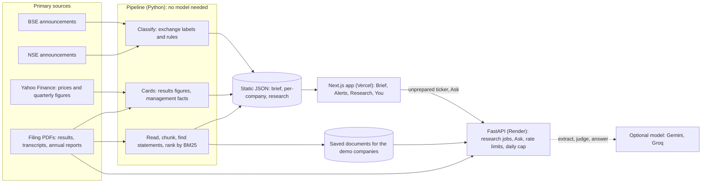

# FINN: a Financial Investment Agent for Indian stocks

FINN is a mobile-first web app with two modes. **Push** is a calm Morning Brief of what changed in a portfolio, with alerts the user sets. **Pull** is research on any NSE company that answers only from its own filings: what management promised on the last four earnings calls, and whether later calls show it happened.

Built for the ENAM AI Engineer Build Challenge. The design rule behind every screen: **a claim is shown only with its source, and a number is never a model's guess.**

## 60-second demo

Open https://finn-mocha.vercel.app on a phone. (The research engine runs on a free server: the first Research action may wake it, up to 2 minutes.)

1. **Brief:** open the Kaynes results card. (When the last 24 hours are quiet the Brief looks back further and says so.)
2. Tap **Figures as printed** to see the source page.
3. **Research → Bajaj Finance:** promises, misses first.
4. Ask **"What did they say about margins?"**
5. **Research TITAN** (never prepared; wakes the free server, up to 2 min).
6. **You → "Try with sample holdings"**, then open a card on the Brief for the calculator.

<table>
<tr>
<td></td>
<td></td>
<td></td>
<td></td>
</tr>
<tr>
<td align="center">Morning Brief</td>
<td align="center">Results card</td>
<td align="center">Management card</td>
<td align="center">Research</td>
</tr>
</table>

More screens: [Following feed](docs/screens/13-following-feed-light.png) · [Following, nothing followed yet](docs/screens/14-follow-starter-light.png) · [Portfolio card](docs/screens/11-portfolio-summary-light.png) · [My investments with sample holdings](docs/screens/12-my-investments-sample-light.png) · [Old data](docs/screens/15-stale-data-brief-light.png) · [Interested tab](docs/screens/08-interested-light.png) · [Time-window sheet, dark](docs/screens/09-window-sheet-dark.png) · [Live research on a company never prepared (TITAN)](docs/screens/10-live-research-titan-light.png) · [Alerts](docs/screens/04-alerts-light.png) · [Research home](docs/screens/05-research-light.png) · [You](docs/screens/07-settings-light.png).

## What it does

**Push**
- **Morning Brief.** One line under the heading, counted in code for the window ("1 risk to review", "Busy day: 6 of your companies filed", or "Quiet day: nothing needs action across your 18 companies"). Then the filings of 18 portfolio companies, **grouped by company** and ranked so risks come before good news: each company once (badge, name, price), each of its filings in three lines (a bold headline; a grey line with an icon, a short label such as Results, M&A, People, Legal or Fund raise, a reason of about eight words, and a Risk, Watch or Good tag). The date, price trend, numbers, PDF and the full reason are one tap away. At most five companies a group, routine filings collapsed into one row, a finite end ("You're all caught up"), a greeting, and one time-window control (a sliders button and a bottom sheet) shared with Alerts. Good and bad are soft tints with a 3px edge, never loud fills, and a word or an arrow always sits beside the colour: a risk is a pale red card, a gain a pale green one, a watch item pale amber, and neutral and routine cards have no tint.
- **Results card.** Revenue, EBITDA, PBT and PAT, quarter on quarter and year on year, read from the results PDF itself. Changes and margins are computed in code, EBITDA is labelled as computed, and every figure is checked against Yahoo Finance and marked as matching, differing or not checked.
- **Management card.** Who, in what role, from when, and the filing's own profile of them (Schedule III asks companies to include one).
- **Alerts.** Unusual end-of-day moves and the filing types the user chooses, against thresholds the user sets (default: more than ±5% or more than 2× the 20-day average volume). Moving a slider changes the alerts instantly. A calm dot on the tab, never a count. Every alert states its reason against the reader's own limit ("Price −6.1% · your limit ±5%") and whether a filing from the same day explains the move, or "No filing explains this move". Any company can be muted.
- **You.** A profile without an account: an initials circle and an optional name (kept in this browser only, used for the greeting), the 18 portfolio companies with "Show in my brief" switches (off means muted, and the row turns grey), My investments, preferences (time window, price and volume lines, which filings alert), three principles (bad news first, every claim has a source, no gamification) and the data sources.
- **My investments, profit and loss, and What if.** Optional, and kept on the phone only: how much you put into each company and, if you know it, the average price you paid. With a buy price FINN shows profit and loss (shares = amount ÷ buy price, worth now = shares × the latest close); without one it shows only today's move and never a made-up profit. The top of the Invested tab gets a **portfolio card** (total invested, current value, overall ▲▼ ₹ and %, and today), tinted green or red by your overall result, with a per-company breakdown, biggest loss first. A company's header reads "Your ₹50,000 · ▼ ₹775 today · ▲ ₹4,200 overall" (overall only when there is a buy price). **Try with sample holdings** fills clearly labelled SAMPLE amounts and buy prices (it asks before replacing anything you typed, and Clear removes only the samples). In an open Brief card and at the top of every Research page, a **What if** calculator restates real moves in rupees: today's move and the last 30 days' (both from the real price history; the 30-day row is left out if the history is too short), then a slider from −20% to +20% with quick chips ("If it moves −10%: you'd have ₹9,000 (▼ −₹1,000)"). Every figure is the amount times a real move, worked out in one tested helper; it predicts nothing and says it is not advice.
- **Old data, quiet days, a first visit.** Windows are counted from the data's own time, never the device clock. If the data is more than a day older than the device's clock the heading is "Latest highlights", the first line is "Data as of ..." and the footer says "That's everything in the latest data" instead of "all caught up". If the last 24 hours hold nothing material and you have not picked a window, the Brief looks back to 3 days, then 7, and says so (a window you pick is never changed). A first visit shows one dismissible hint, "Tap any card for numbers and sources".
- **Follow companies, people and topics.** On the Interested tab, one search box ("Follow a company, person or topic"), chips with an × to stop, and a **Following** feed of the filings in the window that match anything you follow, in the Brief's own cards: risks first, each filing once, a grey "Because you follow Kaynes Technology India, Results" line, routine filings collapsed, and "No filings about X in the last 7 days" when there are none. A company matches by symbol; a person by their exact full name (case-insensitive, whole words) in a filing's headline, subject or body; a topic by the filing's category or a keyword in its headline (Results, Dividend, Fund raise, M&A, Management change, Credit rating, Orders & contracts, Capex, Legal, Pledging). It covers the 22 companies FINN tracks (18 portfolio, 4 research) and says "Any NSE company is next". It reads filings, not news, and sends no push notification.

**Pull**
- **Research any NSE ticker.** The last four concall transcripts and the latest annual report are found on the exchange, read, and kept. Four companies are prepared in advance; any other ticker is researched on demand in the background while the screen shows its stage.
- **What management said about the future,** found by rule, word for word, with its page and a link that opens the PDF there.
- **Promise Tracker.** Starts with one line counted in code: "Delivered 2 of 5 promises that came due" (Kept and Partly, out of Kept, Partly, Missed and Not followed up; promises not yet due are left out), a stacked bar led by Missed, one plain line on what it means, and which model judged. Then the promises, **bad news first** (Missed, Not followed up, Partly, Kept), each in three lines: the verdict and a topic, a short word-for-word excerpt, and "Said in Q3 FY26 call → checked in Q2 FY27 call". Tap for the full quote with a link that opens the PDF at its page, what a later call says, and the reason. Promises not due yet are one collapsed row. A promise is only called Kept, Partly or Missed once its date has passed; the date and the arithmetic are decided in code, not by the model.
- **Ask the documents.** Answers only from the filings, or says "Not found in the documents".

## What is verified, and what is not

I would rather you hear this from me than find it.

| Part | Status |
|---|---|
| Morning Brief, Alerts, You (profile and settings), classification of every filing | Real data for 18 companies from BSE, NSE and Yahoo; verified in a phone-sized browser, light and dark |
| Results card, management card | Real filings: 7 results PDFs (including a scan, a sideways page and a lender) and 4 management filings; **no model is used**; scans are refused unless an independent source confirms them |
| Documents, statements, retrieval, Ask (passages) | Run on real transcripts and annual reports for Bajaj Finance, Asian Paints, HAL, Info Edge, and on Titan, which was never prepared and was researched on demand, on a home connection and again on Render (through NSE) |
| Promise verdicts and the model router | **Run live on 15 Nov 2026** (Gemini free tier) on 4 companies: 3 got verdicts (40 promises: 6 Kept, 1 Partly, 1 Missed, 3 Not followed up, 29 Too early); HAL has one call in the window, so it shows statements and no verdicts. The first run was too generous (24 of 54 Kept), so due dates, number checks and a second reading of every decided verdict were added; I then read each decided verdict against the transcript. Right: Asian Paints "almost 10 lakh" vs "more than 9 lakh" is Partly (90%); Bajaj "book below INR 1,500 crore by Sept '26" vs "now INR 2,400 crore" is Missed (62.5%); the VAE facility "started in September" is Kept; Naukri's "billings growth to recover in Q1" (about 99acres) was wrongly "Not followed up" until retrieval learned to search the business unit named before the promise, and is now Kept with the Q2 call's "Billings grew by 21% YoY in Q2, up from 17% in Q1". Not audited line by line: a few verdicts (for example Bajaj's "Not followed up" on a balance-sheet run-off) may be wrong in the same way. The strong model's free quota is 20 requests a day and ran out during re-runs, so most of these verdicts were made by `gemini-3.5-flash-lite` (each record says which model answered). Every quote is verified word for word |
| Written answers ("Ask the documents") | **Run live on 15 Nov 2026** on all four companies: answered with quotes and pages (Bajaj, Asian Paints, HAL); a question the documents cannot answer returned "Not found in the documents"; Naukri's answer was cut back to bare quotes because it contained a figure its quotes did not support |
| Live checks on the evening of 15 Nov 2026 | **TITAN, never prepared, researched live on the deployed engine (through NSE):** four transcripts read, 8 promises (1 Not followed up, 7 Too early), a question answered with four quotes and an unrelated one answered "Not found", in 34 seconds; no annual report was in NSE's feed, and the record says so. **Naukri's 99acres verdict is fixed:** Kept, with "Billings grew by 21% YoY in Q2, up from 17% in Q1" (Q2 FY27 call, page 5); it had been "Not followed up" |
| The look and the screens (Brief, Alerts, You, Research, Interested) | Checked on the live site in a phone-sized Chromium at 360 and 390 px, light and dark: no console error, no sideways scroll, every text colour at 4.5:1 or better. The last full run on the live site passed 582 of 583 scripted checks (`scripts/check_live.py`) (the one that failed was the engine answering 404 for a ticker nobody had researched; it now answers 200, Render was redeployed, and those scenarios were re-run: 58 of 58). **Not tested on a real phone** |
| My investments, profit and loss, the portfolio card, sample holdings, What if | Real prices only (the latest complete close and the stored history); amounts and buy prices never leave the browser. 38 unit tests on the money maths (profit, loss, zero, a missing buy price, a missing price, ₹1 lakh crore, half-rupee rounding, the summary's order and its "2 of 3" counts, the sample and the store), and scripted checks in a phone-sized browser on the real data: the figures, Indian grouping, a bad number refused, the confirm before samples replace your own entries, every tap target 44 px. **It restates the past in rupees; it forecasts nothing, and says it is not advice** |
| Deployment (Vercel, Render) | **Live.** Backend on Render's free plan (Singapore): https://finn-api-v8fm.onrender.com. Frontend on Vercel: https://finn-mocha.vercel.app ("Engine online" confirmed from the live page). Neither deploys on push: Render deploys are triggered through its API, Vercel's from the command line. BSE answers HTTP 403 to Render, so the engine falls back to NSE (see [docs/data-sources.md](docs/data-sources.md)): **research on a ticker that was never prepared works live**: TITAN, in 32 seconds, read four transcripts from NSE's archives and answered a question with quotes. Its annual report was not found, and the record says so |
| Price chips, sparklines, charts, window sheet | Real prices for 22 companies (Yahoo), 30 sessions each; the chip uses the latest complete session. Checked at 390 px in light and dark on the live site |
| Follow companies, people and topics; the Following feed | Rules over the real filings of the 22 companies (18 portfolio, 4 research), unit-tested (25 tests) and checked in a phone-sized browser: a company by symbol, a person by exact full name, a topic by category or keyword, each filing once with all its reasons, honest "No filings about X" lines, search, and the × to stop. **A different spelling of a name will not match, a keyword rule can miss an unusual wording, and it sends no push notification.** It reads filings, not news |
| Old data, quiet days, tints, the first-visit hint | Checked by moving the page's clock ten days on (heading "Latest highlights", "Data as of", an honest footer, not empty), against the real data for the quiet-day window (a window you pick is never changed), and for the exact tint mix in light and dark (every text at 4.5:1 or better on every tint). Found by looking at the data: on a Monday morning the last 24 hours held nothing material |
| Invest | **A concept**: a "coming soon" sheet with no order flow, marked Preview in the app. The Interested tab's companies, prices and verdicts, and the Following feed, are real |
| Push notifications | Not built, and the Alerts screen says so. They need a server holding subscriptions, which means accounts |
| Web search for management bios | Not built; the filing's own profile answers the question without a key |

Browser checks: `backend/.venv/Scripts/python scripts/check_live.py https://finn-mocha.vercel.app` walks every screen at 360 and 390 px, light and dark; `scripts/perf_audit.py` measures speed.

To rebuild the Promise Tracker: put `GEMINI_API_KEY`, `LLM_CHEAP_MODEL` (and optionally `LLM_STRONG_MODEL`, `GROQ_API_KEY`, `LLM_FALLBACK_MODEL`) in `.env`, then run `python -m pipeline.research` from `backend/`.

## Speed and accessibility (measured, not Lighthouse)

**Lighthouse was not run.** The environment I built in would not let me download and run it, and I did not work around that. `scripts/perf_audit.py` measures the same things in a real Chromium against the live site, with the settings Lighthouse's mobile run simulates (slow 4G at 1.6 Mbps and 150 ms, a CPU 4x slower), median of 5 loads. These are my measurements, not Lighthouse scores:

| Page | First paint | Largest paint | Layout shift | Blocking time | Transferred | In-page failures |
|---|---|---|---|---|---|---|
| Brief | 0.70 s | 1.63 s | 0.001 | 0 ms | 312 KB | none |
| Alerts | 0.66 s | 1.55 s | 0.001 | 0 ms | 276 KB | none |
| Research | 0.61 s | 1.50 s | 0.041 | 0 ms | 304 KB | none |
| You | 0.65 s | 1.56 s | 0.001 | 0 ms | 275 KB | none |

All four are inside Lighthouse's "good" limits (first paint 1.8 s, largest paint 2.5 s, layout shift 0.1, blocking time 200 ms). The in-page checks are: language, title, description and viewport; one h1 and headings in order; a name on every button, link and field; `noopener` on external links; text at least 12 px; tap targets (most are 44 px, none under 24 px); nothing scrolls sideways. What it changed: the two data files every screen reads are now preloaded with the page, the hidden Interested tab is not drawn until it is needed, a sentence that appeared in the heading after the data loaded (it pushed the page down, layout shift 0.093) now sits under the tabs, and one small link became a full-size tap target. For the official scores: `npx lighthouse https://finn-mocha.vercel.app --form-factor=mobile --view`.

## How it avoids making things up

- **No model reads a results PDF.** Figures come from word positions on the page, and a figure it cannot read is dropped, never guessed. A column whose total income does not equal revenue plus other income is dropped.
- **A quote is shown only if it is word for word on the page it cites.** The check forgives line breaks, hyphenation, curly quotes and ligatures, and nothing else; a changed number or word fails. The page number comes from FINN's own chunk, never from a model.
- **A verdict needs a quote from a later call, and Kept, Partly and Missed only come after the promise's date has passed.** The date is read by code from the speaker's words, a number counts only if it is in the quotes (met, 75 to 99% Partly, below 75% Missed), a miss needs a word of a miss in its quote, and a second reading checks the quote is about the same thing. Without a quote that holds up, the card is set back and says so.
- **Counts, deltas, margins and the delivery rate are computed in code.** An answer's figures must appear in its own quotes.
- **A source that disagrees is shown, not hidden:** the Yahoo check says "differs", a scan nothing can confirm says "figures not shown", an unreadable filing says so.
- **Data is labelled with its age.** Windows are counted from the data's own timestamp and the page says when the data was produced. Data more than a day older than the device's clock is called old ("Latest highlights", "Data as of ..."), never passed off as today's, and a quiet window looks further back and says so.
- Document text is treated as data, never as instructions.

## Research behind the design

These are the findings the design leans on, and what FINN does about each. FINN does not test them; they are reasons, not results. The references, and what each does and does not show, are in [docs/write-up.md](docs/write-up.md#research-behind-the-design).

| Finding | What FINN does |
|---|---|
| When many companies report on the same day, investors react less to each one (Hirshleifer, Lim & Teoh, 2009) | A short, ranked Brief, and a "Busy day: N of your companies filed" line that says when attention is stretched |
| Investors who check their portfolios often feel losses more and hold less equity (Benartzi & Thaler, 1995; Lee & Veld-Merkoulova, 2016) | One calm Brief that ends ("You're all caught up"), not a feed |
| Investors look at their accounts less when they expect bad news; logins fell 9.5% after a market decline (Karlsson, Loewenstein & Seppi, 2009; Sicherman, Loewenstein, Seppi & Utkus, 2016) | Risks first, and "N risks to review", so bad news is put in front of the reader, not left to be avoided |
| Individual investors buy attention-grabbing stocks (Barber & Odean, 2008) | Spike alerts are calm and give their reason; there is no buy button anywhere near an alert |
| Alerts get overridden: 93% of 2,455 medication alerts in four days (Bryant et al., 2014); 73.3% in a hospital study (Nanji et al., 2018) | A dot on the Alerts tab, not a count; a reason on every alert; routine filings collapsed into one row |
| Robinhood removed its confetti animation in March 2021 amid criticism of gamification (CNBC, 31 Mar 2021) | No confetti, streaks, scores or reward animations |
| Groww's minimal, jargon-free design for first-time investors (design inspiration, from press coverage) | Three-line cards in plain words |
| Sparklines (Tufte); calm technology (Weiser & Brown, 1995) | The price trend is a small line behind a tap; the interface stays at the edge of attention and speaks when something needs it |

## Architecture



Push data is precomputed into static JSON, so it loads instantly and the browser applies the user's own thresholds. The backend is only needed for research on an unprepared ticker and for Ask; a free Render instance sleeps, so the app shows an honest "waking up" state. Settings live in the browser: there are no accounts and nothing personal is stored. More in [docs/architecture.md](docs/architecture.md).

## Cost and efficiency

Most of FINN uses **no model at all**: classification of every filing (exchange labels plus rules), the results and management cards, the statements found by rule, retrieval ("Not found" is decided by word overlap before any model is asked). A model is used for three things only: extracting promises (a cheap model, about 14 short excerpts per call), judging them against later calls (a strong model), and writing an answer to a question (a cheap model, six short excerpts). That is roughly seven calls per company for the whole tracker, every answer is cached by its input, the prompt version and the model, and no whole document is ever sent. Every call is logged without the prompt or the key.

**Measured over the whole session (the live runs and their re-runs): 222 successful calls, 81 of them answered from the cache, about 385,000 tokens in and 36,000 out on this laptop, $0 on the free tier.** (Research the deployed engine did on its own, such as TITAN, is not in that log.) The first run alone was 25 calls and about 71,000 tokens in for 3 companies. `python -m app.core.llm` prints the table. Details in [docs/cost.md](docs/cost.md).

## Run it

Needs Python 3.14 (the version Render uses) and Node 20.9 or newer.

```
cd backend
python -m venv .venv
.venv/Scripts/python -m pip install -r requirements-dev.txt     # macOS/Linux: .venv/bin/python
.venv/Scripts/python -m uvicorn app.main:app --port 8000

cd frontend
npm install
npm run dev                                                      # http://localhost:3000
```

Refresh the data (writes `frontend/public/data/`; commit it to update a deployed app):

```
cd backend
.venv/Scripts/python -m pipeline.run --research     # the portfolio and the research companies: filings, prices, cards, brief.json and research_brief.json
.venv/Scripts/python -m pipeline.research           # the Promise Tracker for the research companies; add --symbols HAL for one
```

Tests: `cd backend && .venv/Scripts/python -m pytest` (683 tests) and `cd frontend && npm test` (213 unit tests), plus type-check, lint and a production build. Copy `.env.example` to `.env` for keys (never commit it), and run `bash scripts/install-hooks.sh` once in a fresh clone to enable the secret-scan pre-commit hook.

## Where things are

```
backend/app/sources/   BSE, NSE, Yahoo and PDF downloads (allow-listed hosts, 25 MB cap)
backend/app/push/      classify, rank, results and management cards
backend/app/pull/      ingest, chunk, retrieve, promises, ask, research engine
backend/app/core/      model router, cache, safe HTTP, security
backend/pipeline/      run.py (portfolio) and research.py (research companies)
frontend/              Next.js app: app/, components/, lib/ (pure logic, unit-tested)
config/                portfolio, research companies, categories and their weights
docs/                  decisions, data sources, architecture, cost, deploy, build log
```

## Decisions and history

- [docs/decisions.md](docs/decisions.md): 24 decisions made up front and 137 made while building, each with its reason.
- [docs/data-sources.md](docs/data-sources.md): what was verified about every source before anything was built on it, including what failed.
- [docs/build-log.md](docs/build-log.md): what each step asked, did, verified and got wrong.
- [docs/write-up.md](docs/write-up.md): the approach in two pages.
