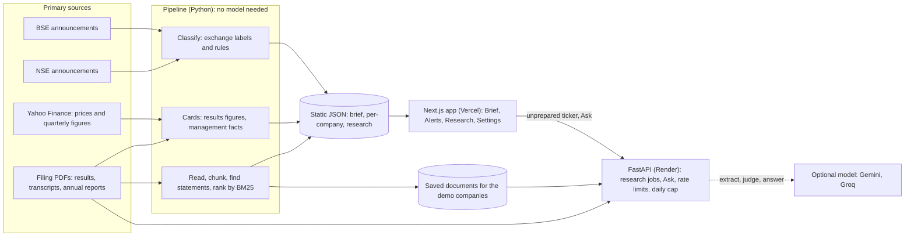

# Architecture

## The three flows

**1. Push (precomputed).** The pipeline (`python -m pipeline.run`) fetches each portfolio company's announcements (BSE first, NSE for issuers BSE does not list), prices and Yahoo's quarterly figures. It classifies every filing with the exchange's own labels and keyword rules, ranks it (risks above good news, with a one-line reason), and for each results or management filing downloads the PDF once and builds a card from it. Everything is written as static JSON. The browser loads it at run time, counts windows from the data's own timestamp, and applies the user's thresholds itself, so changing a setting is instant and needs no server.

**2. Pull, prepared in advance.** For the four demo companies (`python -m pipeline.research`) the documents are read once. The record (documents, statements, and a Promise Tracker if a model is configured) is written beside the other static data, and the documents' text is saved compressed with the backend, so "Ask the documents" works without reaching the exchanges.

**3. Pull, on demand.** For any other ticker the screen asks the backend. A background job finds the filings, reads them, builds the record and caches it, and the screen follows the job's stage. A free Render instance sleeps after 15 idle minutes and takes about a minute to wake, which the screen says plainly.

## How the pieces are kept honest

- **No model in the push path.** Classification, ranking, the results card (including EBITDA, margins, QoQ and YoY) and the management card are deterministic, so they are reproducible and cost nothing per filing.
- **A model is used for three things only** (promise extraction, judging against later calls, writing an answer) and is never trusted for them: every quote it returns must appear word for word on the page it is credited to, the page number comes from FINN's own chunk, a verdict needs a later quote, and the counts and rate are computed in code.
- **Every download goes through one safe fetch**: an allow-list of hosts (BSE, NSE, Yahoo, screener.in, Tavily), a 25 MB cap, timeouts, redirects re-checked. Model calls go only to fixed provider hosts, with keys in headers and never in logs.
- **Every failure has a state.** A source that fails keeps the last good data and says how old it is; a filing that cannot be read becomes a card that says so; an engine that is asleep is "waking up", not an error.

## Where the pipeline runs

On the developer's laptop for now, committing its JSON, because BSE and NSE are only proven reachable from a home connection (see [data-sources.md](data-sources.md)). The deployed backend is used only for on-demand research and Ask, and the demo companies do not depend on it reaching the exchanges.

## Settings and keys

Settings live in the browser (localStorage); there are no accounts and nothing personal is stored. Keys exist only in the pipeline's and the backend's environment, never in the front end, and `.env` is git-ignored with a secret scan on every commit.

Why each choice was made: [decisions.md](decisions.md). What has actually been verified about each data source: [data-sources.md](data-sources.md).
